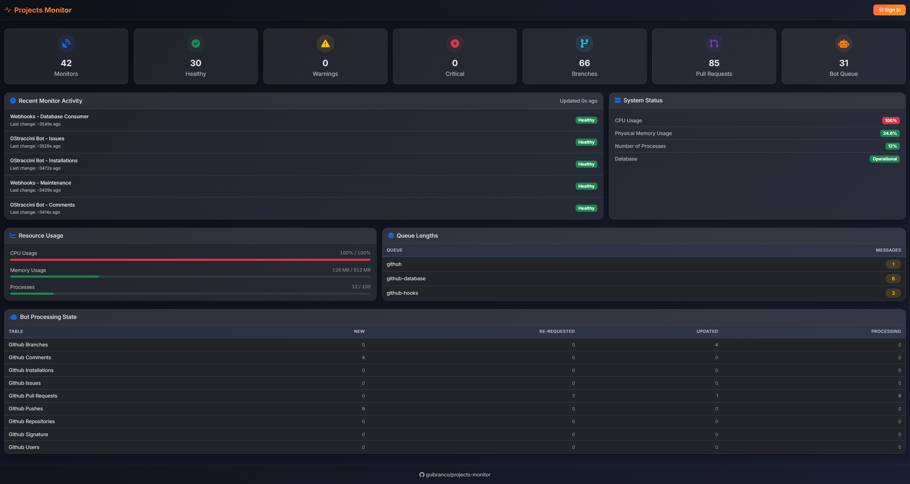
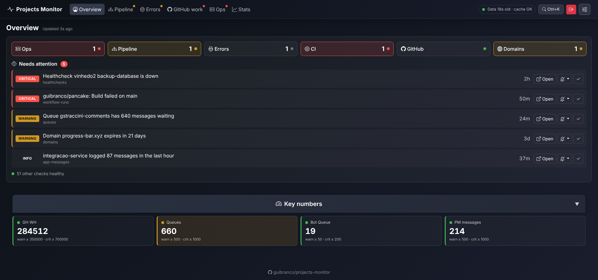
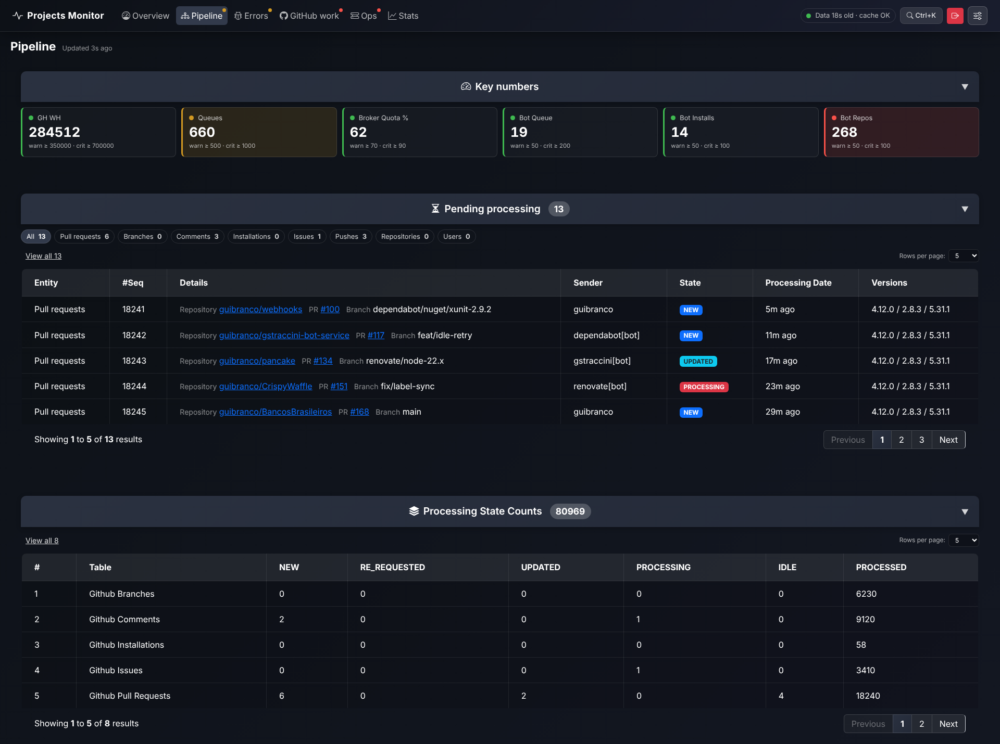
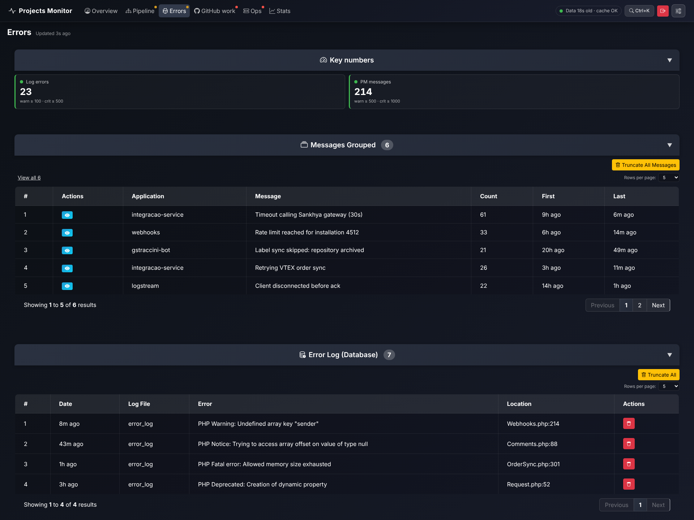
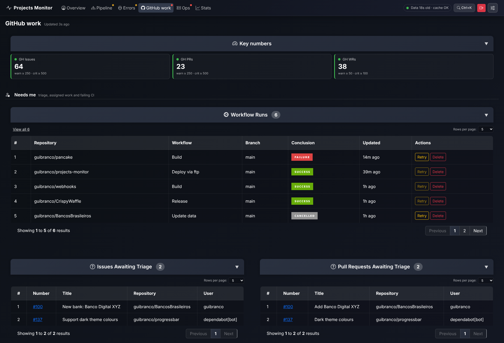
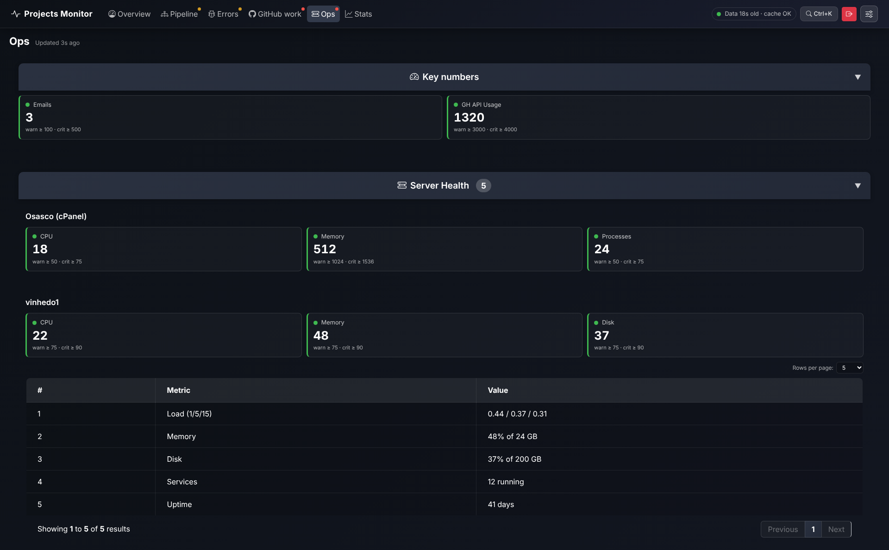
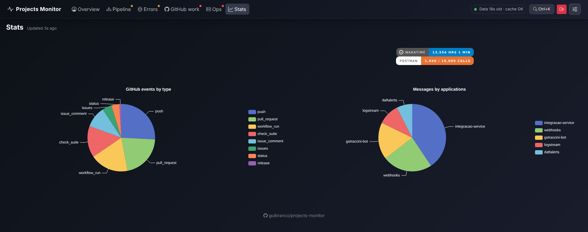

# Projects Monitor


⚙️ 🔔 A "flight control panel" for GitHub repositories, personal projects, and
the infrastructure behind them — pull requests, issues, webhooks, health checks,
DNS, queues, and error logs, in one authenticated dashboard that opens on what
needs attention.

[](https://wakatime.com/badge/github/guibranco/projects-monitor)
[](https://github.com/guibranco/Projects-Monitor/actions/workflows/build.yml)
[](https://github.com/guibranco/Projects-Monitor/actions/workflows/deploy.yml)
[](https://sonarcloud.io/summary/new_code?id=guibranco_projects-monitor)
[](https://codeclimate.com/github/guibranco/projects-monitor/maintainability)
[](https://codeclimate.com/github/guibranco/projects-monitor/test_coverage)
[](https://www.codefactor.io/repository/github/guibranco/projects-monitor)

---

## Overview

Projects Monitor is a PHP dashboard backed by a REST-like API (`Src/api/v1`). It logs in over a session-based auth flow, then renders live tiles and gauges for every service the author's projects depend on — GitHub, cPanel, RabbitMQ, WireGuard, Vercel, Render, and more — so an outage or a stuck queue is visible at a glance instead of buried in a dozen separate dashboards. A preview of the login and dashboard screens is at the bottom of this README.

### Features

- **Needs attention (manage by exception)** — the top of the dashboard shows
  only what is wrong right now: a status strip with one tile per domain (Ops,
  Pipeline, Errors, CI, GitHub, Domains) coloured by its worst item, a "Needs
  attention" list sorted by severity then age with inline Open / Re-run / Snooze
  / Acknowledge, a one-line summary of everything healthy, and a data-freshness
  indicator in the navbar that turns amber when the public stats worker stops
  writing its cache. See [Attention feed](#attention-feed).
- **GitHub integration** — open/pending pull requests, issues across repositories, workflow runs (failures highlighted), API rate-limit usage, and the latest releases of tracked projects.
- **Webhooks & automation** — GitHub webhook statistics and processing-state
  counts, plus the live webhook workers and GStraccini Bot job runs, with their
  Run buttons, on the Pipeline page.
- **Infrastructure health** — HealthChecks.io, UpTimeRobot, AppVeyor CI, Cloudflare domains (each zone's status — paused wins — plan and activation date, linked to the Cloudflare dashboard, plus the last 7 days of traffic from the GraphQL Analytics API: requests, cache ratio, bandwidth, visitors — the sum of each day's unique visitors — and page views), and Vercel project status (the production deployment's state, overridden by the project's paused flag and by what its production URL actually answers — `DEPLOYMENT_DISABLED`, `DEPLOYMENT_PAUSED`, `DEPLOYMENT_NOT_FOUND`, a 5xx or an unreachable host — each URL probed at most once every 10 minutes) and Render service status (the latest deploy's status, overridden by the service's suspended flag); CloudAMQP/RabbitMQ queue, message, consumer, and connection stats; WireGuard VPN client/connection status over SSH; a remote server health report (load average, CPU/memory/swap/disk usage, pending-reboot flag, and key systemd service states) collected by running a `monitor-report` script on the host over the same SSH connection.
- **Domains** — registrar and lifecycle information (expiration, transfer status) via IP2WHOIS, plus a dedicated [DNS Records page](Src/dns.php) listing every zone record (A, CNAME, MX, TXT, ...) pulled live from cPanel, filterable by source domain/record type and sortable by any column.
- **Logs & errors** — cPanel error logs and SQL-backed application errors, aggregated with grouping and statistics by application or error content.
- **Public stats** — a pre-computed, unauthenticated stats page fed by a cron worker (see [Background workers](#background-workers)).
- **Interactive API docs** — a Swagger UI served at `/api/v1/swagger`, backed
  by the OpenAPI spec at `/api/v1/openapi` (both public; *Try it out* needs a
  dashboard login).

---

## Tech stack

- **PHP 8.2+** (the Docker image is pinned to `php:8.6.0RC4-apache`), Apache, Composer.
- **MariaDB/MySQL** for errors, messages, and user accounts.
- **[guibranco/pancake](https://github.com/guibranco/pancake)** for HTTP requests and shared helpers, `phpseclib/phpseclib` for SSH/WireGuard checks, `fastvolt/markdown` for rendering release notes.
- **Docker Compose** for local development: an Apache/PHP app container, a MariaDB container, and [Mailpit](https://github.com/axllent/mailpit) standing in for a real mailserver.
- **PHPUnit** for unit tests; shell scripts under `Tests/` and `Tools/` for smoke tests, DB integrity checks, and migrations.

---

## Requirements

- PHP 8.2 or later, with the `mbstring`, `mysqli`, `sockets`, `shmop`, and `zip` extensions.
- Composer.
- MariaDB or MySQL.
- Docker and Docker Compose (recommended for local development — see below).

---

## Local development

The repo ships a `docker-compose.yml` with everything needed to run the app locally:

```bash
git clone https://github.com/guibranco/projects-monitor.git
cd projects-monitor
docker compose up -d
```

This starts three containers:

| Service    | Purpose                              | Local address           |
| ---------- | ------------------------------------- | ------------------------ |
| `www`      | Apache + PHP 8.6.0RC4 app             | http://localhost:8000    |
| `database` | MariaDB (`test`/`test`)               | localhost:3306            |
| `mailpit`  | Catches outbound mail from `mail()`   | http://localhost:8025 (UI), `1025` (SMTP) |

Apply the SQL migrations in `Sql/` (in order) to the `test` database — `Tools/db-migration.sh` does this in CI and can be run the same way locally.

### Secrets

Each integration lazily loads its own file from `Src/secrets/`, so you only need to create the ones for the integrations you're working with — everything else fails closed with a `SecretsFileNotFoundException` instead of breaking the rest of the dashboard. At minimum, local development needs `mySql.secrets.php`:

```php
<?php
$mySqlHost     = "database";
$mySqlUser     = "test";
$mySqlPassword = "test";
$mySqlDatabase = "test";
```

The full set of integrations and their secrets files:

| Integration                | Secrets file                        |
| --------------------------- | ------------------------------------ |
| MySQL/MariaDB               | `mySql.secrets.php`                  |
| GitHub                      | `gitHub.secrets.php`                 |
| AppVeyor CI                 | `appVeyor.secrets.php`               |
| cPanel                      | `cPanel.secrets.php`                 |
| Cloudflare                  | `cloudflare.secrets.php`             |
| HealthChecks.io             | `healthChecksIo.secrets.php`         |
| UptimeRobot                 | `upTimeRobot.secrets.php`            |
| Vercel                      | `vercel.secrets.php`                 |
| Render                      | `render.secrets.php`                 |
| RabbitMQ / CloudAMQP        | `rabbitMq.secrets.php`               |
| SSH (also used for WireGuard status and the server health report) | `ssh.secrets.php` |
| IP2WHOIS (domain lookups)   | `Ip2WhoIsSecrets.php`                |
| Postman                     | `postman.secrets.php`                |
| Webhooks project            | `webhooks.secrets.php`               |
| WebhooksHandler (broker usage) | `webhooksHandler.secrets.php`     |
| github-api-proxy (GitHub API usage) | `githubApiProxy.secrets.php` |
| GStraccini Bot              | `gstracciniBot.secrets.php`          |
| LogStream                   | `logStream.secrets.php`              |
| OneSignal (critical pushes) | `oneSignal.secrets.php`              |

GitHub API calls (issues and pull requests search, releases, rate limit,
Actions billing usage) go through github-api-proxy, so they show up in its
stats. `gitHub.secrets.php` holds `$gitHubToken` and `$gitHubApiUrl`, the
proxy's pass-through host (`https://github-proxy.gstraccini.dev/`); the deploy
writes it from the `GH_API_BASE_URL` repository variable, defaulting to that
host. Set the variable to `https://api.github.com/` to bypass the proxy; when
`$gitHubApiUrl` is missing (local development) calls go straight to GitHub.

The github-api-proxy secrets file holds `$githubApiProxyUrl` (its stats API,
e.g. `https://api.github-proxy.gstraccini.dev/`) and `$githubApiProxyToken`
(the proxy's `Admin--ApiToken` from Grimoire); the deploy writes it from the
`GH_API_PROXY_URL` and `GH_API_PROXY_TOKEN` repository secrets. This host must
be in the proxy's `Network:AllowedSources`.

The OneSignal secrets file holds `$oneSignalAppId`, `$oneSignalApiKey` (the
App API key), and optionally `$oneSignalSegment` (default `Total
Subscriptions`) and `$oneSignalSiteUrl` (the dashboard's base URL, so a
push opens the right page). The deploy writes it only when the
`ONESIGNAL_API_KEY` repository secret is set (App ID from the
`ONESIGNAL_APP_ID` variable or the one the page script uses, site URL from
`INSTALLATION_ENDPOINT`); without it `NotifyAttention.php` does nothing.

The Cloudflare API token needs **Zone → Zone → Read** and
**Zone → Analytics → Read**. Without the analytics permission the
Cloudflare tile still lists the zones, with a dash in every traffic column.

### GitHub Actions billing

`Src/Library/github-billing.json` (validated against `github-billing.schema.json`) is the source of truth for which GitHub accounts are polled for Actions included-usage (minutes/storage) and how each account's quota is resolved — see [GitHubBillingConfig.php](Src/Library/GitHubBillingConfig.php). Each account is an independent billing pool: minutes, storage, and reset dates are never summed across accounts, only compared for a "highest utilisation" warning.

- **To change a plan** (e.g. an org upgrades from `free` to `team`), edit that account's `planType` in the JSON — no code change needed. `overrides` (per-account `minutes`/`storageMb`) win over the plan default; use them when GitHub's billing page shows a different allowance than the published plan table (see the `_source` link in the JSON).
- **Validation is eager and loud**: an unknown `planType`, or an `accountType` the plan doesn't allow (e.g. an org marked `pro`), throws `GitHubBillingConfigException` naming the offending account rather than silently producing a wrong percentage.
- **Token scopes**: the shared `gitHubToken` from `gitHub.secrets.php` needs to cover Actions billing reads for every configured account — a classic PAT needs `admin:org` (for the org endpoints) plus user/plan read for the personal account; a fine-grained PAT needs "Plan" (user, read) and "Administration" (org, read). If one token can't cover every account, set that account's `tokenSecret` in the JSON to the name of another global variable defined in `gitHub.secrets.php` (the JSON only ever holds a variable *name*, never a token value).
- **Where the numbers come from**: allowances come from the JSON, not the API — GitHub's usage endpoints don't return the included quota. `GitHubActionsUsage` also infers an allowance from `discountAmount`/`pricePerUnit` per SKU and logs a warning (category `github-billing`) when it diverges from the configured value by more than 5%, as an early signal that a plan changed and the JSON is stale.

### WireGuard clients

The WireGuard tile lists each peer reported by the `monitor-report`
script. `Src/Library/wireguard-clients.json` (validated by
[WireGuardClientsConfig.php](Src/Library/WireGuardClientsConfig.php);
`wireguard-clients.schema.json` describes it for editors) maps a peer's
allowed IPs to the name shown in the **Peer** column. To add, rename or
remove a client, edit the JSON; no code change is needed.

```json
{
    "$schema": "./wireguard-clients.schema.json",
    "version": 1,
    "clients": [
        {
            "allowedIps": "10.141.230.2/32",
            "name": "GH Actions - Projects Monitor"
        }
    ]
}
```

- `version` is an integer, currently `1`.
- `allowedIps` must match the peer's allowed IPs exactly as WireGuard
  reports them, `/32` suffix included; `name` is the display name. Both
  are required, non-empty strings, and each `allowedIps` may appear only
  once. No other property is allowed.
- Peers without an entry are shown by their allowed IPs.
- **Missing file**: the tile still works, showing every peer by its
  allowed IPs, and a warning is logged (category `wireguard`).
- **Invalid file** (malformed JSON, a missing or unexpected property, a
  wrong type, a blank value or a duplicate `allowedIps`): the
  `WireGuardClientsConfigException` message names the file and the JSON
  path at fault, e.g. `$.clients[1].name must be a non-empty string`. It
  is logged as an error (category `wireguard`) and the tile falls back
  to allowed IPs.

### Tests

```bash
composer install --working-dir=Src
vendor/bin/phpunit -c Tests/phpunit.xml   # unit tests
bash Tests/smoke-tests.sh                  # hits the running app's key endpoints
bash Tests/db-integrity.sh                 # checks the applied schema
```

### Dashboard pages

The dashboard is split by the question each page answers. Every page has the
same navbar: one tab per page (with a red or amber dot when the attention feed
has active items in that page's domains), the global repo filter, the data
freshness indicator, and a Ctrl+K palette to jump to any page or section.

- **Overview** (`index.php`) — Is anything broken? Status strip, Needs
  attention, key numbers.
- **Pipeline** (`pipeline.php`) — Is the webhook/bot pipeline healthy? Pending
  processing (one table with entity chips), processing state counts, idle PRs,
  queues and brokers, workers, bot jobs, feed, senders, repositories, webhook
  statistics.
- **Errors** (`errors.php`) — What's failing in my code? One list
  (`GET /api/v1/errors-inbox`) of application messages, PHP errors stored in
  the database and `error_log` entries not ingested yet, grouped by
  fingerprint (where it happens plus the message with numbers and ids taken
  out, so an error keeps its group before and after `ProcessErrorLogs` ingests
  it) with a chip per source; plus the error log files and messages by
  application lists for their delete actions.
- **GitHub work** (`github.php`) — What needs me on GitHub? Needs me, Waiting on
  others, Blocked and Activity groups.
- **Ops** (`ops.php`) — Is my infra up? Server health, Healthchecks.io,
  UptimeRobot, WireGuard, domains, cronjobs, Cloudflare, Vercel, Render,
  AppVeyor, GitHub API and Actions usage.
- **Stats** (`stats.php`) — How am I doing? GitHub stats and streak, Wakatime,
  Postman, pie charts.

Each page loads only its own endpoints (`LOADERS` in `Src/static/api.js`).
Design rules applied everywhere: colour only for status, sections whose counter
is 0 are hidden and listed in one line at the bottom of the page, tables show 5
rows with "View all", dates show relatively with the exact time on hover, and
the old gauges are KPI tiles with their thresholds and a 24h sparkline.

- **KPI history** is kept on the server (`kpi_samples`, via
  `GET`/`POST /api/v1/kpi-history`): every open dashboard sends the values it
  shows, batched at most once a minute, and stores one sample per metric per
  minute for `kpi.history.retentionHours`. Every browser draws the same trend;
  a gap means no dashboard was open then.
- **Repo filter**: the navbar box (or `/` to focus it, Ctrl+K "Filter every
  page by repo", or `?repo=` in the URL) filters every page. Tables with a
  Repository / Repo / Project column only show matching rows, with a line
  saying how many are hidden; the Needs attention list hides workflow-run
  items of other repositories. Tables and items that do not belong to a
  repository are not filtered. The value is kept per browser.

### Attention feed

`GET /api/v1/attention` decides what needs attention; the dashboard only renders
it. One evaluator per source lives in `Src/Library/Attention/Evaluators/`
(Healthchecks.io, UpTimeRobot, servers and database from the public stats cache,
broker queues, the GStraccini-bot webhooks backlog, application messages, PHP
errors, cPanel `error_log` files, the latest run of each workflow of the
followed accounts, the GitHub API core quota and domain expiry). Each item has a
`source`, `domain`, `severity` (`critical` = broken, `warning` = degraded),
`title`, `since`, `link`, `actions` and a stable `fingerprint`.

- **Thresholds** default to `Src/Library/attention-thresholds.json`. To change
  one without a deploy, insert a row into `attention_thresholds`, e.g. `INSERT
  INTO attention_thresholds (name, value) VALUES ('queue.messages.warning',
  500);` (delete the row to go back to the default).
- **Snooze and acknowledge** are stored by fingerprint in `attention_states`
  (`POST /api/v1/attention/state`). A snooze hides the item until it ends; an
  acknowledgement keeps it listed (dimmed) but stops counting it until the
  item's `since` changes. Ended snoozes and acknowledgements of items no longer
  raised are pruned on the next full evaluation.
- **Caching**: sources are evaluated at most once per
  `cache.attention.ttlSeconds` (snapshot in `Src/cache/attention.json`;
  `?refresh=1`, or clicking the freshness indicator, forces a new one). A source
  without its secrets file is reported as `not_configured`; one that fails
  becomes a warning item of its own, so a broken integration never passes for a
  healthy one.
- **Push notifications**: `Src/Worker/NotifyAttention.php` (cron, every 5
  minutes) pushes **critical**, active items to the dashboard's OneSignal
  subscribers, once per raise: an item is pushed again only when its `since`
  changes or after it went away and came back (`attention_notifications`).
  Warnings, snoozed and acknowledged items never push. More than
  `notify.maxPushesPerRun` new items in one run become a single summary push.
- **Adding a source**: write an `AttentionEvaluator` (a `fetch()` that reads, an
  `evaluate()` without I/O that decides) and list it in `AttentionSources`.

### Background workers

Three CLI workers are meant to run on a cron schedule against the deployed
instance (see the docblock in each file for the exact crontab line):

- `Src/Worker/GeneratePublicStats.php` — pre-computes the public stats page every 5 minutes.
- `Src/Worker/ProcessErrorLogs.php` — polls cPanel for `error_log` files, persists them to the `errors` table, and cleans them up.
- `Src/Worker/NotifyAttention.php` — pushes critical attention items through
  OneSignal every 5 minutes (needs `oneSignal.secrets.php`).

---

## Authentication

Access to the dashboard requires login credentials, stored in the `users` table. A password-recovery flow is available at `reset.php`.

---

## API

The dashboard is backed by a REST-like API under `/api/v1`, documented with a live Swagger UI:

- **Swagger UI:** `/api/v1/swagger`
- **OpenAPI spec:** `/api/v1/openapi`

Both are public, so the API can be browsed without logging in. *Try it out* only
works while you are logged in to the dashboard in the same browser: Swagger UI
is served from the same origin as the API, so the browser attaches the
`PHPSESSID` session cookie by itself (nothing needs to be entered in the
*Authorize* dialog — browsers do not let scripts set the `Cookie` header). For
anonymous visitors *Try it out* is hidden and the protected endpoints answer
`401`.

Key endpoint groups: `attention` / `attention/state`, `github`, `webhooks*`
(statistics, per-entity processing, worker control), `gstraccini-jobs` /
`gstraccini-job-run`, `appveyor`, `cloudflare`, `cpanel`, `dns-records`,
`domains`, `healthchecksio`, `uptimerobot`, `vercel`, `render`, `queues` /
`queues-purge`, `wireguard`, `system-report`, `messages*` / `errors*` (log
retrieval, details, deletion), and `public-stats`.

---

## Deployment

`deploy.yml` builds a versioned release (via [GitVersion](https://gitversion.net/), GitHubFlow), writes each integration's secrets file from GitHub Actions secrets, zips `Src/` into `deploy.zip`, and ships it over FTP. `install.php` unpacks the zip on the target server and removes itself. The workflow runs on every push to `main`.

### Branding

The logo lives in [`Src/static/brand/`](Src/static/brand/): `logo.svg` (navbar
and README), `favicon.svg` / `favicon-32.png` / `apple-touch-icon.png` (browser
icons), and `logo-512.png` — a 512×512 PNG for places that need a raster image,
such as the Projects Monitor GitHub App's display picture.

---

## Preview

### Login

The login page, with basic (public) information:


### Dashboard

The authenticated dashboard is split into six pages. The screenshots below
use demo data.

#### Overview page

Status strip, "Needs attention" list and key numbers:


#### Pipeline page

Webhooks and bot processing: pending processing, state counts, idle pull
requests, queues and brokers:


#### Errors page

One list of errors from every source, grouped, with a chip per source:


#### GitHub work page

Workflow runs, triage, assigned issues and pull requests:


#### Ops page

Server health, uptime, domains, DNS and hosting:


#### Stats page

GitHub, WakaTime and Postman stats, events and messages by application:


---

## Contributing

Contributions are welcome! Feel free to fork this repository, submit a pull request, or open an issue to suggest or request improvements.

---

## License

MIT — see `composer.json`.
